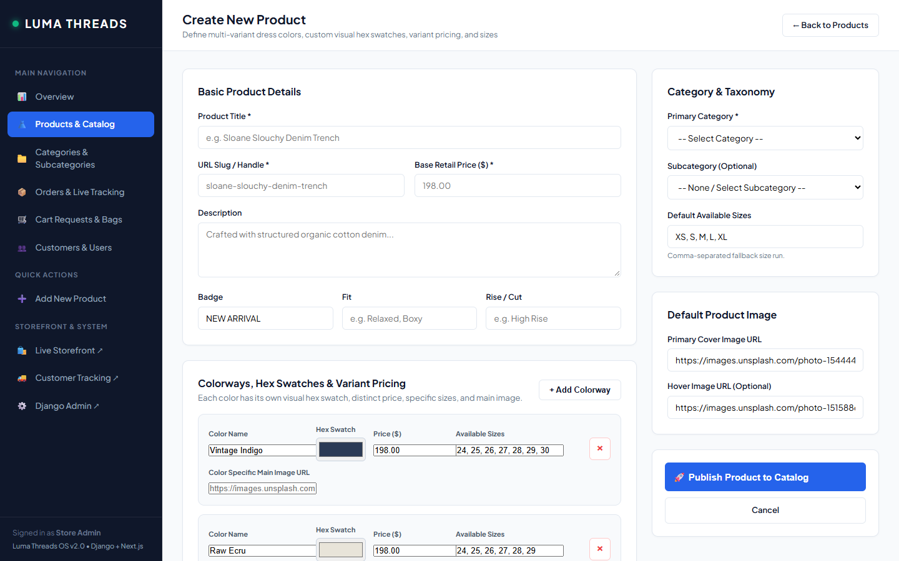
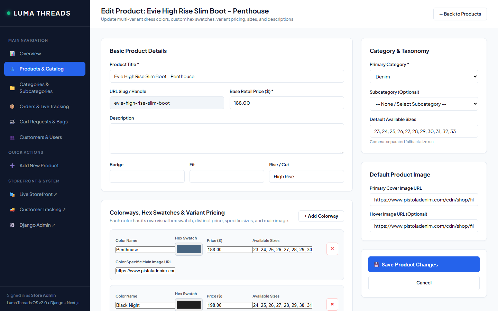
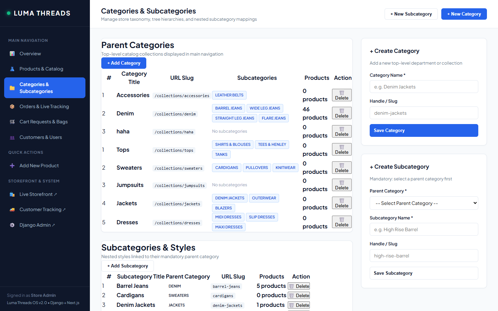
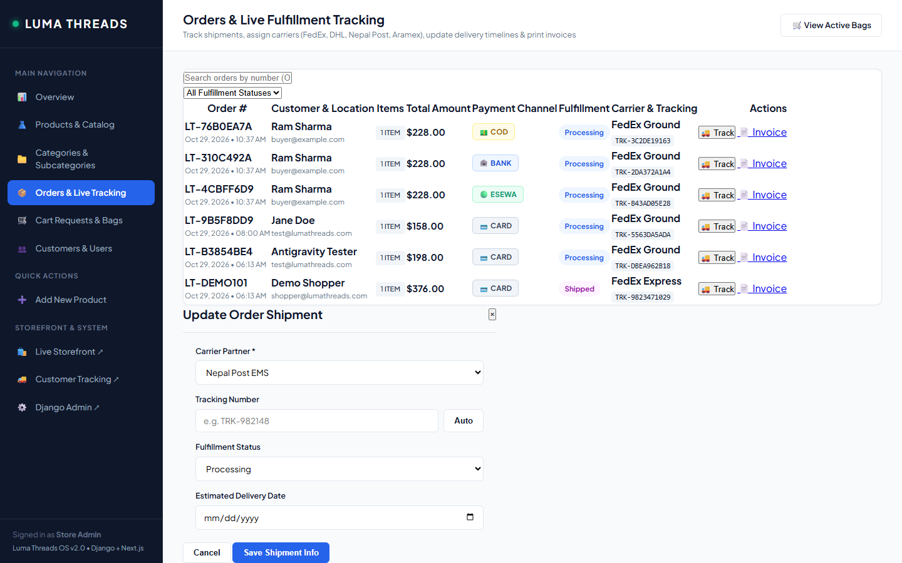
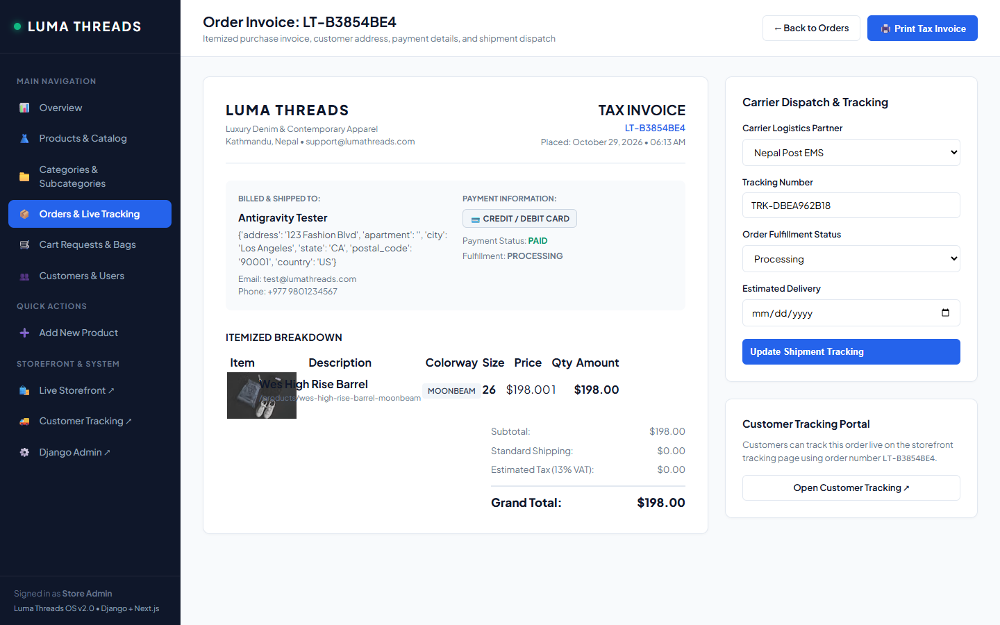
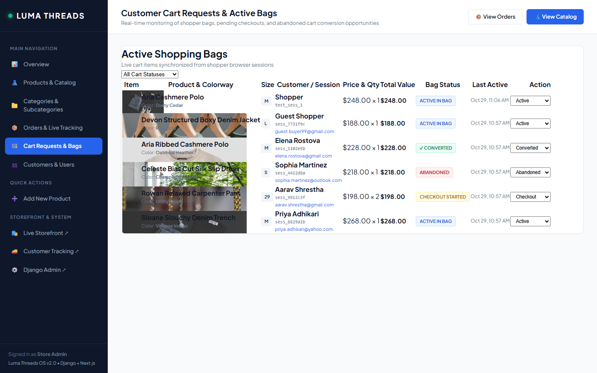
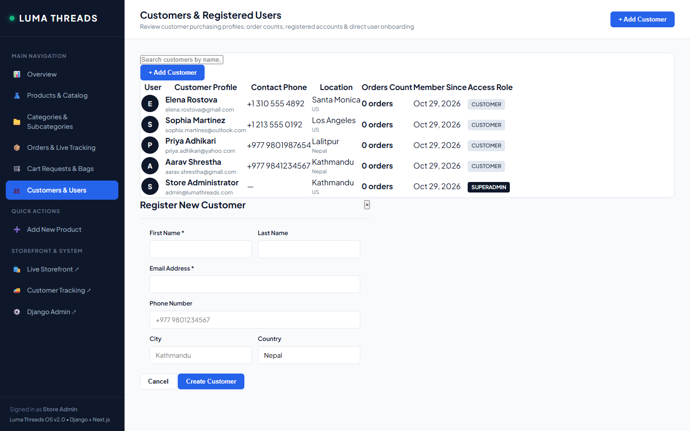

# LUMA-THREADS

A high-performance modern e-commerce platform and industry-level store management suite built with **Next.js 15 (React 19, Tailwind CSS)** and **Django 5.2 (REST Framework, SQLite)**.

---

## 📸 Visual Showcase & Screen Previews

### 🛍️ Customer Storefront Experience

#### 1. Home Page & Editorial Showcase


#### 2. Collection & Denim Catalog


#### 3. Dynamic Colorways & Swatches (Aria Ribbed Cashmere Polo)
*Each individual color swatch dynamically updates the product image, variant price, and available size options.*


#### 4. Product Detail & Gallery (Devon Structured Boxy Denim Jacket)


#### 5. Shopping Bag & Cart View


#### 6. Multi-Channel Checkout (eSewa, Bank Transfer, COD)
*Integrated with Nepal local payment gateways (eSewa Mobile Wallet, Direct Bank Transfer, and Cash on Delivery).*


#### 7. Customer Order Tracking Portal


---

### 🏢 Store Admin Management Suite (Dedicated Multi-Page Architecture)

Each management module is built as an **independent, dedicated HTML/CSS page** with its own distinct URL, navigation highlight, and view controllers:

#### 8. Overview & Analytics (`/dashboard/` or `/dashboard/overview/`)
*Real-time KPIs: Gross Revenue, Active Orders, Product Catalog count, Customer Base, and Payment Channel distribution.*


#### 9. Product & Inventory Catalog (`/dashboard/products/`)
*Visual hex swatches, per-color pricing chips, size badges, search/filter controls, and edit/delete actions.*


#### 10. Add New Product (`/dashboard/products/add/`)
*Dedicated full creation page with dynamic multi-colorway swatch builder, visual hex color picker, size runs, and category/subcategory filtering.*


#### 11. Edit Product & Colorways (`/dashboard/products/<handle_or_id>/edit/`)
*Dedicated full product editor for updating variant prices, primary images, descriptions, and hex swatches.*


#### 12. Categories & Subcategories Tree Hierarchy (`/dashboard/categories/`)
*Complete taxonomy management page with nested subcategories, product count indicators, and mandatory parent category selection.*


#### 13. Orders & Live Fulfillment Tracking (`/dashboard/orders/`)
*Order status progression, carrier assignment (FedEx, DHL, Nepal Post, Aramex), tracking numbers, and quick dispatch.*


#### 14. Itemized Tax Invoice & Dispatch Detail (`/dashboard/orders/<id>/`)
*Dedicated printable tax invoice page with itemized customer breakdowns, shipping details, and live carrier tracking updates.*


#### 15. Cart Requests & Real-Time Abandoned Bag Monitoring (`/dashboard/cart-requests/`)
*Asynchronous background sync capturing customer shopping bags, checkout drop-offs, and conversion lifecycle states.*


#### 16. Customer Directory & User Profiles (`/dashboard/customers/`)
*Customer purchasing metrics, order counts, role assignments, and manual customer registration.*


---

## 🌟 Key Architecture & Capabilities

### 🛍️ Storefront Architecture (`/web`)
- **Dynamic Swatch Engine:** Distinct price, sizes, and gallery images per color swatch.
- **Deep-Linked Routing:** URL params support direct linking to specific colors (e.g. `/products/aria-ribbed-cashmere-polo?color=Dusty+Cedar`).
- **Cart Sync:** Customer actions asynchronously register to the Django admin Cart Requests table.
- **Payment Methods:** Support for **eSewa**, **Bank Transfer**, **Cash on Delivery (COD)**, and **Credit Cards**.

### 🏢 Store Admin Suite (`/backend/dashboard/`)
- **Multi-Page Architecture:** Each page is an individual HTML & CSS template with its own URL, eliminating single-page display issues.
- **Dedicated Product Editor:** Full separate pages for adding (`/products/add/`) and editing (`/products/<id>/edit/`) products with multi-color swatches.
- **Fulfillment & Tracking Engine:** Assign carrier partners (**FedEx**, **DHL**, **Nepal Post**, **Aramex**) and generate real-time tracking numbers (`TRK-...`).
- **Printable Invoices:** Dedicated invoice view (`/orders/<id>/`) with formatted itemized billing and print layout (`window.print()`).
- **Cart Monitoring:** Real-time visibility into active shopper bags, checkout drop-offs, and conversions.

---

## 🚀 Getting Started

### 1. Prerequisites
- **Python 3.10+**
- **Node.js 18+** & **npm**

---

### 2. Django Backend Setup

```bash
cd backend

# Install dependencies
pip install -r requirements.txt

# Run migrations
python manage.py migrate

# Seed catalog and dashboard demo records
python manage.py seed_catalog
python seed_admin_data.py

# Launch Django server (Port 8000)
python manage.py runserver 8000
```

- **Dashboard:** [http://127.0.0.1:8000/dashboard/](http://127.0.0.1:8000/dashboard/)
- **Django Admin:** [http://127.0.0.1:8000/admin/](http://127.0.0.1:8000/admin/)
  - **Email:** `admin@lumathreads.com`
  - **Password:** `adminpassword123`

---

### 3. Next.js Frontend Setup

```bash
cd web

# Install dependencies
npm install

# Launch Next.js dev server (Port 3000)
npm run dev
```

- **Storefront:** [http://localhost:3000](http://localhost:3000)

---

## 📁 Repository Structure

```
├── backend/
│   ├── accounts/             # Authentication & user directory
│   ├── lumathreads/          # Core Django project configuration & URLs
│   ├── orders/               # Orders, tracking, and CartRequest models
│   ├── products/             # Product models, APIs, and dashboard views
│   ├── static/css/           # Admin dashboard stylesheet (dashboard.css)
│   ├── templates/            # Admin dashboard templates (dashboard.html)
│   └── manage.py
├── web/
│   ├── app/                  # Next.js App Router (pages, layout, checkout)
│   ├── components/           # UI components (Header, ProductCard, CartDrawer)
│   ├── lib/                  # Catalog data, types, and API connectors
│   └── package.json
├── screenshots/              # High-resolution screenshots of all pages & modals
└── README.md
```

---

## 📄 License
MIT License.
