# LUMA-THREADS

A high-performance modern e-commerce platform and industry-level store management suite built with **Next.js 15 (React 19, Tailwind CSS)** and **Django 5.2 (REST Framework, SQLite)**.

---

## 📸 Visual Showcase & Screen Previews

### 🛍️ Customer Storefront Experience

#### 1. Home Page & Editorial Showcase
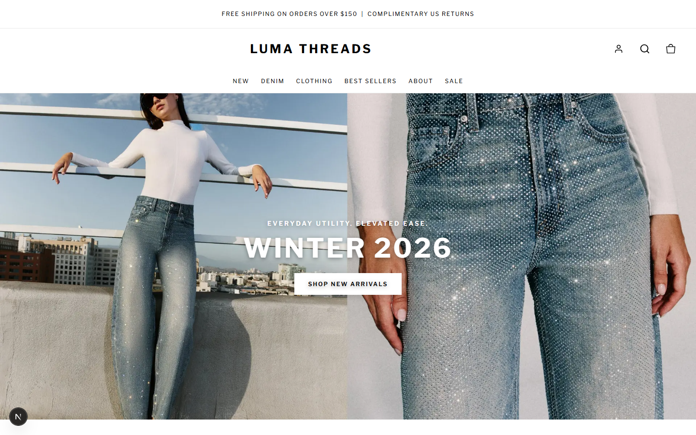

#### 2. Collection & Denim Catalog
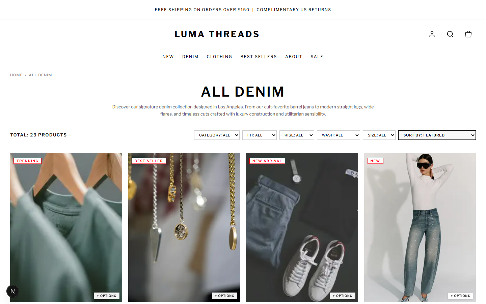

#### 3. Dynamic Colorways & Swatches (Aria Ribbed Cashmere Polo)
*Each individual color swatch dynamically updates the product image, variant price, and available size options.*
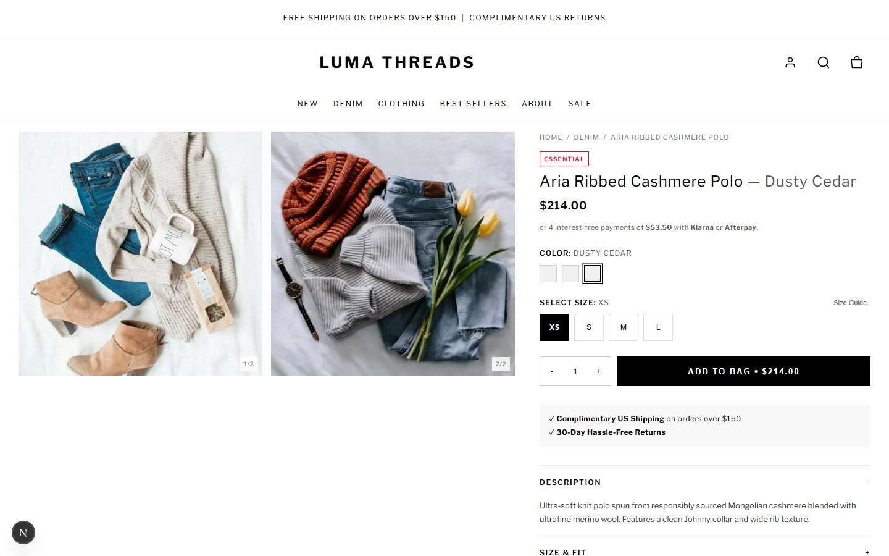

#### 4. Product Detail & Gallery (Devon Structured Boxy Denim Jacket)
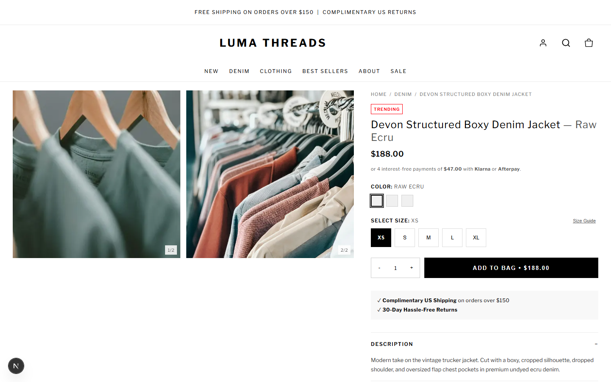

#### 5. Shopping Bag & Cart View
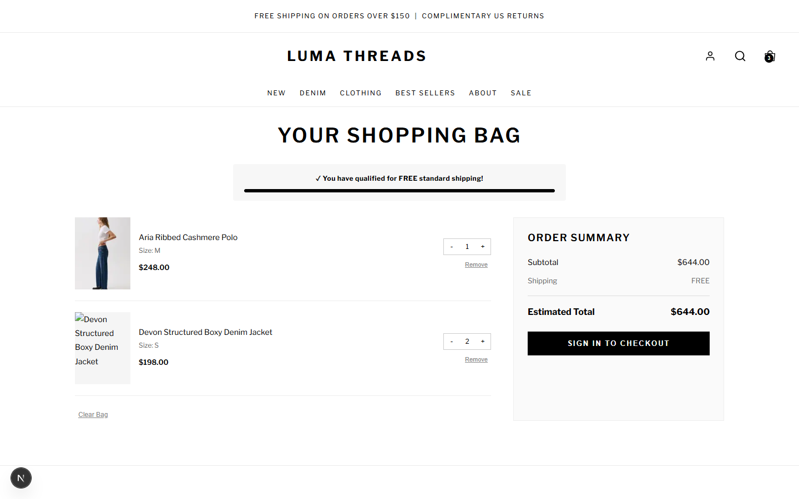

#### 6. Multi-Channel Checkout (eSewa, Bank Transfer, COD)
*Integrated with Nepal local payment gateways (eSewa Mobile Wallet, Direct Bank Transfer, and Cash on Delivery).*
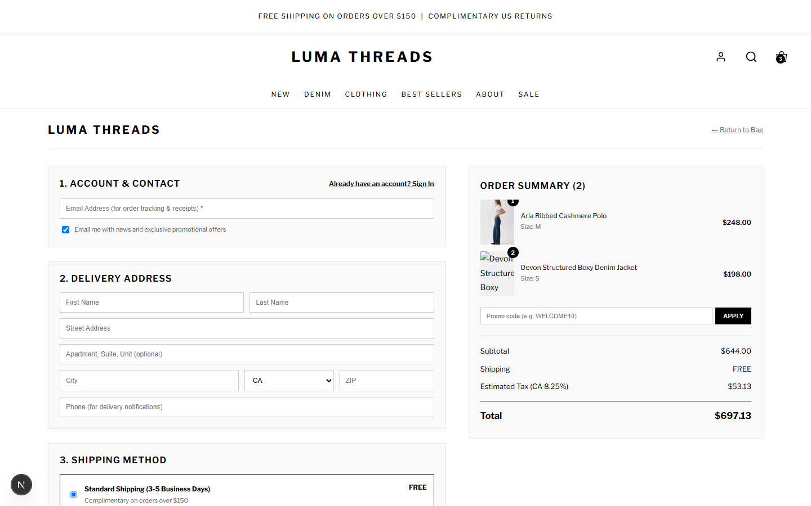

#### 7. Customer Order Tracking Portal
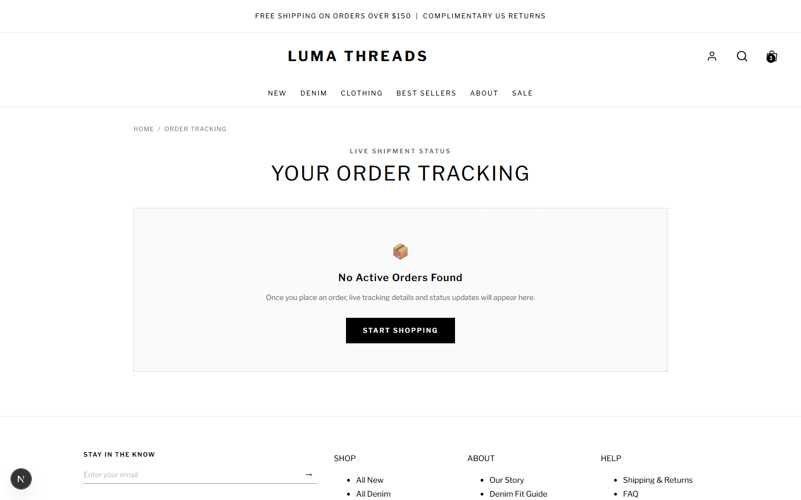

---

### 🏢 Store Admin Management Suite (`/dashboard/`)

#### 8. Admin Overview & Analytics Dashboard
*Real-time KPIs: Gross Revenue, Active Orders, Product Catalog count, Customer Base, and Payment Channel distribution.*
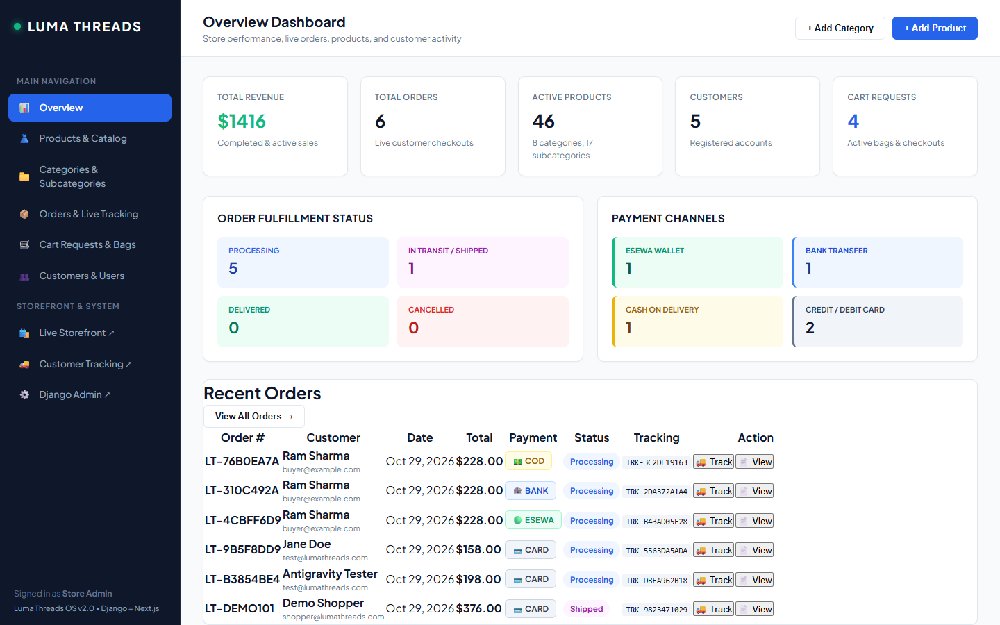

#### 9. Product & Inventory Management
*Visual hex swatches, per-color pricing chips, size badges, and full CRUD operations.*
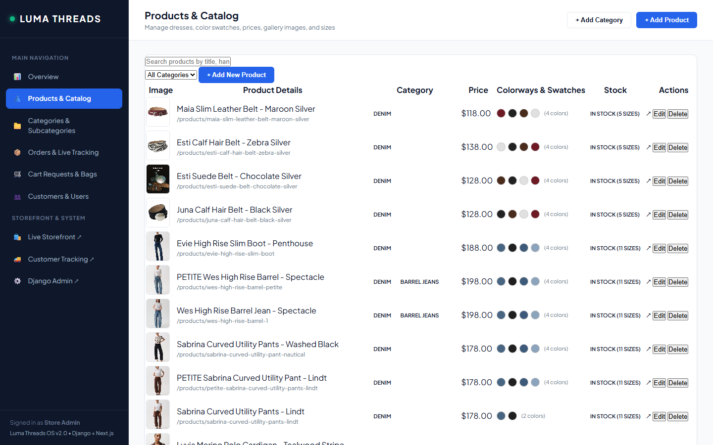

#### 10. Categories & Subcategories Tree Hierarchy
*Category hierarchy tree with mandatory parent category enforcement for subcategory creation.*
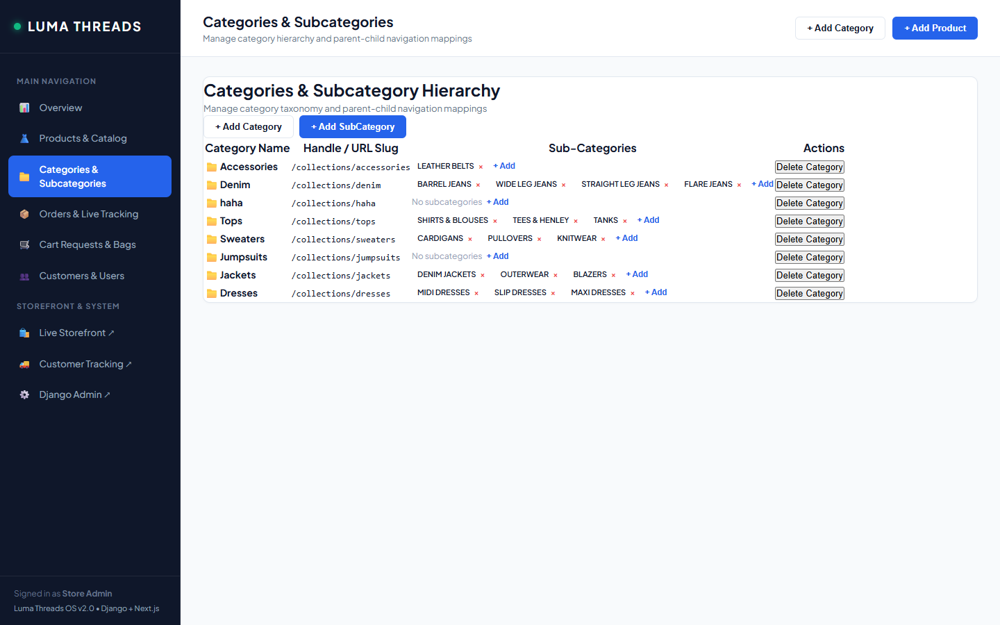

#### 11. Orders & Live Fulfillment Tracking
*Order status progression, carrier assignment (FedEx, DHL, Nepal Post, Aramex), and live tracking numbers.*
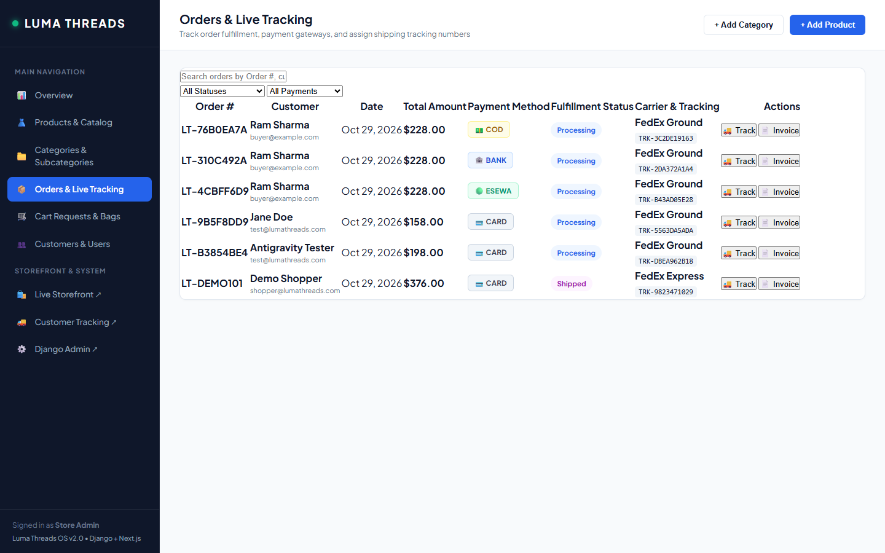

#### 12. Cart Requests & Real-Time Abandoned Bag Monitoring
*Asynchronous background sync capturing customer shopping bags, checkout drop-offs, and conversion opportunities.*
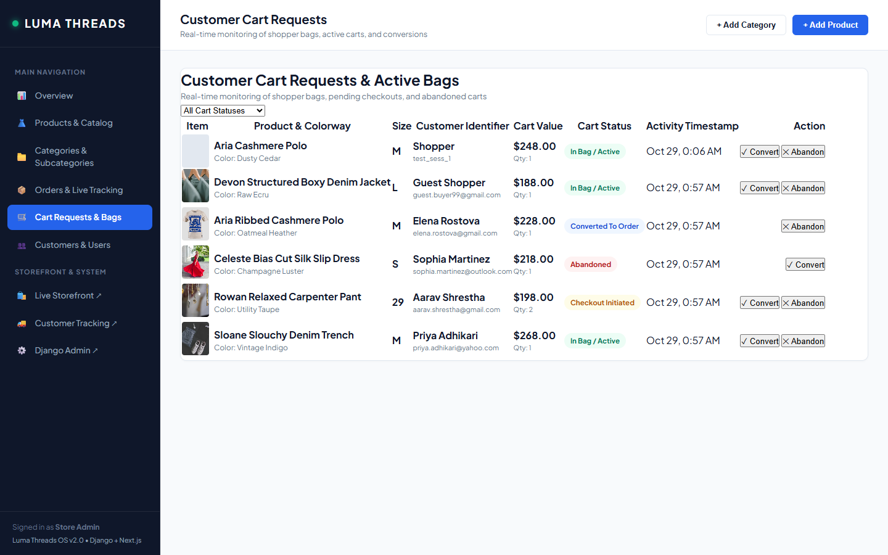

#### 13. Customer Directory & User Profiles
*Customer spend metrics, order counts, and manual customer registration.*
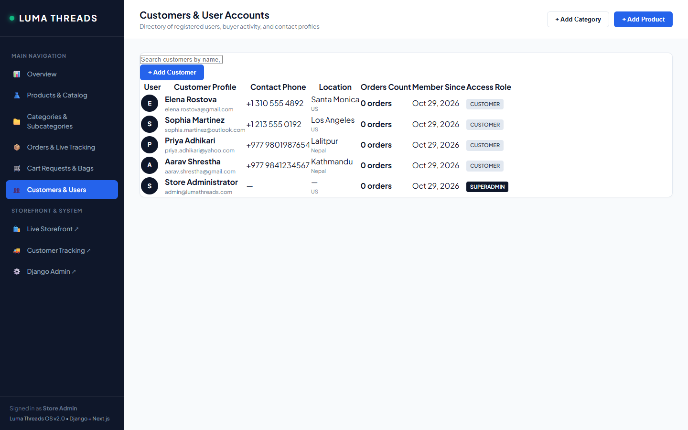

#### 14. Carrier Assignment & Shipment Tracking Modal
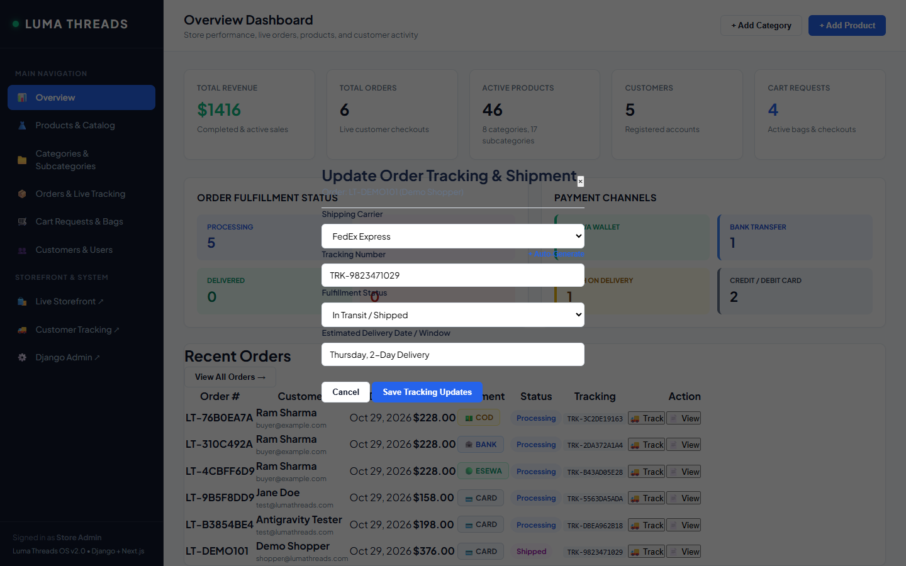

#### 15. Itemized Printable Tax Invoice Modal
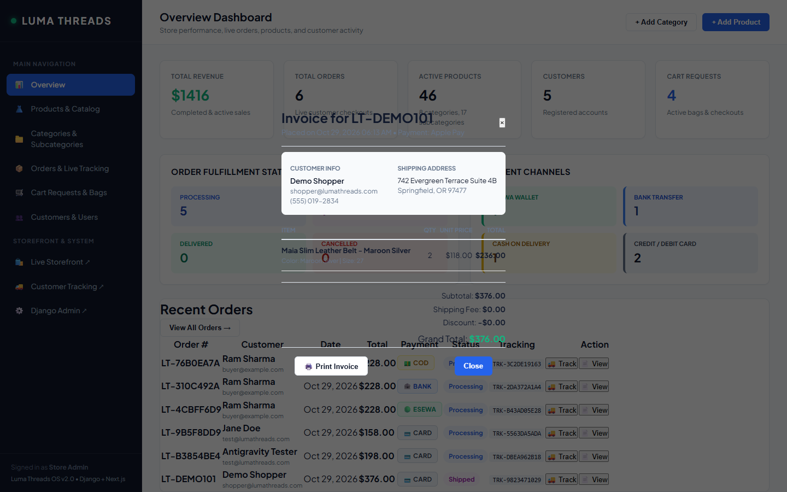

#### 16. Dynamic Product Creator with Visual Hex Picker
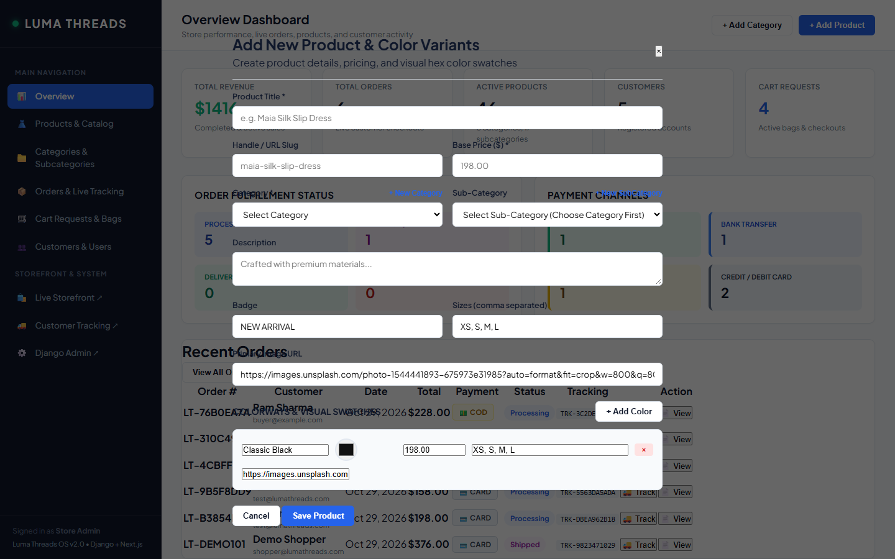

---

## 🌟 Key Architecture & Capabilities

### 🛍️ Storefront Architecture (`/web`)
- **Dynamic Swatch Engine:** Distinct price, sizes, and gallery images per color swatch.
- **Deep-Linked Routing:** URL params support direct linking to specific colors (e.g. `/products/aria-ribbed-cashmere-polo?color=Dusty+Cedar`).
- **Cart Sync:** Customer actions asynchronously register to the Django admin Cart Requests table.
- **Payment Methods:** Support for **eSewa**, **Bank Transfer**, **Cash on Delivery (COD)**, and **Credit Cards**.

### 🏢 Management Dashboard (`/backend/dashboard/`)
- **Single-Page Hash Navigation:** Deep-linked switching between `#overview`, `#products`, `#categories`, `#orders`, `#cart-requests`, and `#customers` with zero page reloads.
- **Shipment Tracking Engine:** Update carrier, tracking ID, and milestone statuses in real-time.
- **Printable Invoices:** Formatted invoice modal with complete billing, tax, and itemized breakdowns.
- **Cart Monitoring:** Tracks active, checkout, converted, and abandoned shopping bags.

---

## 🚀 Getting Started

### 1. Prerequisites
- **Python 3.10+**
- **Node.js 18+** & **npm**

---

### 2. Django Backend Setup

```bash
cd backend

# Install dependencies
pip install -r requirements.txt

# Run migrations
python manage.py migrate

# Seed catalog and dashboard demo records
python manage.py seed_catalog
python seed_admin_data.py

# Launch Django server (Port 8000)
python manage.py runserver 8000
```

- **Dashboard:** [http://127.0.0.1:8000/dashboard/](http://127.0.0.1:8000/dashboard/)
- **Django Admin:** [http://127.0.0.1:8000/admin/](http://127.0.0.1:8000/admin/)
  - **Email:** `admin@lumathreads.com`
  - **Password:** `adminpassword123`

---

### 3. Next.js Frontend Setup

```bash
cd web

# Install dependencies
npm install

# Launch Next.js dev server (Port 3000)
npm run dev
```

- **Storefront:** [http://localhost:3000](http://localhost:3000)

---

## 📁 Repository Structure

```
├── backend/
│   ├── accounts/             # Authentication & user directory
│   ├── lumathreads/          # Core Django project configuration & URLs
│   ├── orders/               # Orders, tracking, and CartRequest models
│   ├── products/             # Product models, APIs, and dashboard views
│   ├── static/css/           # Admin dashboard stylesheet (dashboard.css)
│   ├── templates/            # Admin dashboard templates (dashboard.html)
│   └── manage.py
├── web/
│   ├── app/                  # Next.js App Router (pages, layout, checkout)
│   ├── components/           # UI components (Header, ProductCard, CartDrawer)
│   ├── lib/                  # Catalog data, types, and API connectors
│   └── package.json
├── screenshots/              # High-resolution screenshots of all pages & modals
└── README.md
```

---

## 📄 License
MIT License.
